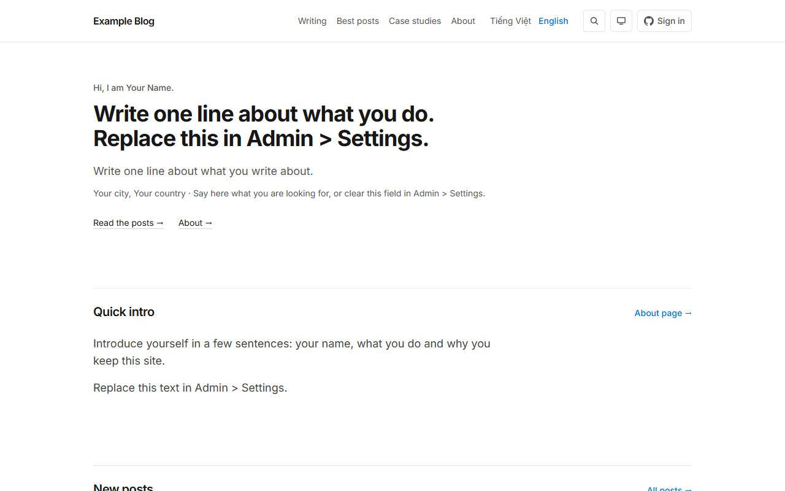
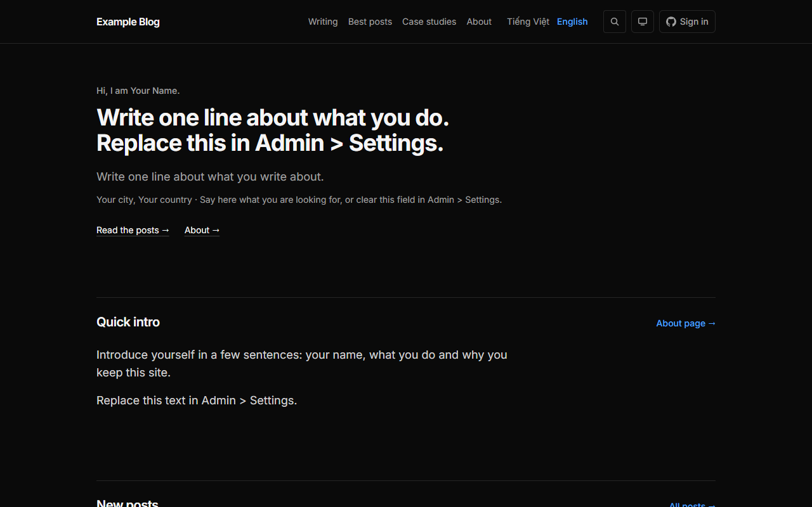
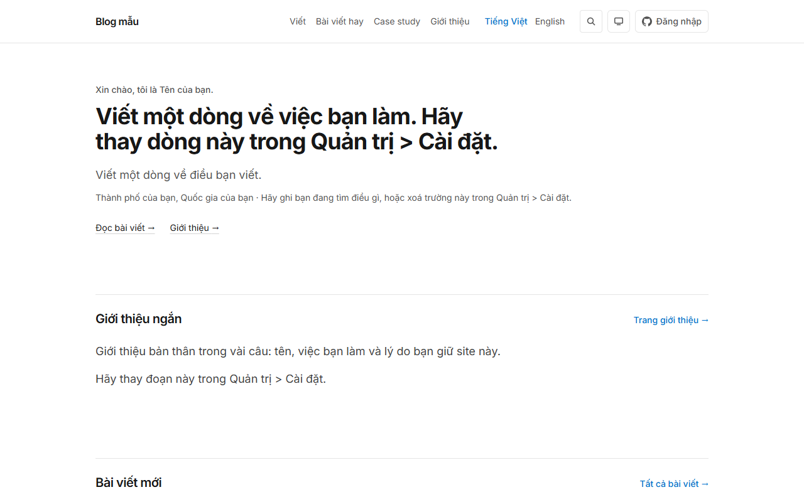
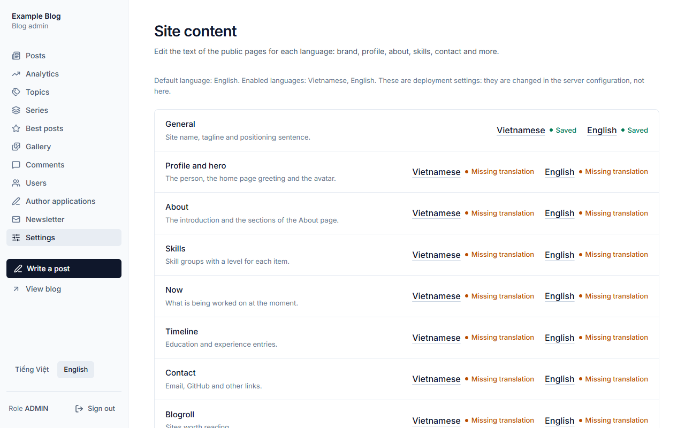

# Blog Engine

A bilingual (English and Vietnamese), self-hostable blog engine: a Spring Boot API, a Next.js site and PostgreSQL, run with Docker
Compose on one small server. The owner edits everything about themselves (site name, profile, about, contact) in the browser, per
language; posts can be written in either language and linked as translations. Readers can optionally sign in with GitHub to
comment, like and save posts, and anyone can subscribe to a newsletter.

Version `1.0.0-rc.1` (release candidate). Vietnamese README: [README.vi.md](README.vi.md).

```
Browser -> Next.js (server rendered) -> Spring Boot REST API -> PostgreSQL
```

The browser never calls the API directly: every request to the backend is made by the Next server, and the auth token lives in an
`httpOnly` cookie on the site's origin, so no client-side JavaScript can read it and there is no CORS to configure.

## Screenshots



Home page, English, light theme. Viewport and date: 1280 x 800, 2026-10-11, taken from a fresh Docker Compose install with the sample content.



Home page, English, dark theme. Viewport and date: 1280 x 800, 2026-10-11, taken from a fresh Docker Compose install with the sample content.



Home page, Vietnamese, light theme. Viewport and date: 1280 x 800, 2026-10-11, taken from a fresh Docker Compose install with the sample content.



Admin settings (site content per language), English. Viewport and date: 1280 x 800, 2026-10-11, taken from a fresh Docker Compose install with the sample content.

## Features

- **Two languages.** English and Vietnamese interface, public and admin. Each post has one language and can be linked to its
  translations; lists, search, feeds and the sitemap follow the page language, and `hreflang` links exist only between published
  translations. The default language has URLs without a prefix. See [docs/CONTENT-AND-I18N.md](docs/CONTENT-AND-I18N.md).
- **Writing.** Markdown posts rendered on the server with syntax highlighting, cover images and body images, revisions, series,
  categories and tags, a curated "Best posts" list, a photo gallery, RSS feeds, a sitemap and structured data.
- **Post import.** Admins and authors upload up to 20 Markdown files or ZIP packages, review a preview and create the posts as drafts (or update their own posts; an admin, any
  post), from a template that can be filled by hand or with an AI assistant
  ([docs/post-file-format.md](docs/post-file-format.md)).
- **Article blocks and AI authoring.** Posts can use native blocks (callouts, figures, comparisons, Mermaid diagrams, steps, code tabs, details and
  more) and be imported as a ZIP package with their images, written by an AI assistant from a generated authoring prompt and previewed in the real
  article page ([docs/content-blocks.md](docs/content-blocks.md), [docs/ai-article-authoring.md](docs/ai-article-authoring.md)).
- **Owner content in the database.** Site name, profile, about, skills, timeline, contact, blogroll and case studies are edited in
  `/admin/settings`, with version history, JSON export and import, and a Markdown profile import (template, preview, undo) that
  can be filled by hand or with an AI assistant. Nothing about an owner is in the code.
- **Readers (optional).** GitHub sign-in, comments with replies, likes, saved posts and notifications.
- **Newsletter.** Two-step confirmation, one mail per post, in the subscriber's language. Real mail needs an SMTP provider and has
  not been verified by the project's own checks.
- **Admin.** Roles (reader, author, admin), mandatory two-step verification for admins (an authenticator app, recovery codes), moderation, user suspension, author applications, first-party view statistics that
  store no IP address or user agent, bulk post actions.
- **Search.** PostgreSQL full-text search that ignores case and diacritics, or optional Meilisearch.
- **Self-hosting.** Docker Compose for a 2 GB server, a first-run `/setup` instead of a default password, Caddy and nginx examples
  with TLS, images stored in PostgreSQL so one `pg_dump` backs up everything.

The complete list is in [docs/FEATURES.md](docs/FEATURES.md).

## Quick start

You need Docker with Compose v2 and a machine with at least 2 GB of RAM. From the root of the repository:

```bash
./scripts/init-env.sh                # on Windows PowerShell: .\scripts\init-env.ps1
docker compose up -d --build
```

`init-env` writes `.env` with random secrets and refuses to overwrite an existing one. The first build takes several minutes. Then
open <http://localhost:3000/setup> and claim the site with the setup code the backend wrote to a file:

```bash
docker compose exec backend sh -c 'cat /data/setup-code'
```

At `/setup` you choose your display name, email and password; then you sign in at `/admin/login`, set up an authenticator app for the
second step (save the recovery codes), fill in the site under
Admin, Settings, and optionally load the sample content from the same page. A public site needs a domain, `SITE_URL=https://...`
and a reverse proxy with TLS: see [docs/INSTALL.md](docs/INSTALL.md).

## Documentation

| Read | For |
|---|---|
| [docs/INSTALL.md](docs/INSTALL.md) | Install with Compose, prebuilt images or from source, TLS with Caddy or nginx, optional GitHub login, SMTP and search. |
| [docs/FIRST-RUN.md](docs/FIRST-RUN.md) | The setup code, `/setup`, site name and languages, sample content, your first post. |
| [docs/CONFIGURATION.md](docs/CONFIGURATION.md) | Every environment variable, build argument and tuning property. |
| [docs/CONTENT-AND-I18N.md](docs/CONTENT-AND-I18N.md) | Languages, URLs, translations, search, and how to add a language. |
| [docs/ADMIN-GUIDE.md](docs/ADMIN-GUIDE.md) | Settings, Markdown import, posts and translations, roles and permissions, newsletter. |
| [docs/UPGRADING.md](docs/UPGRADING.md) | Upgrading a running site. |
| [docs/BACKUP-AND-RESTORE.md](docs/BACKUP-AND-RESTORE.md) | Backups and restores. |
| [docs/TROUBLESHOOTING.md](docs/TROUBLESHOOTING.md) | When something does not start or work. |
| [docs/ARCHITECTURE.md](docs/ARCHITECTURE.md) | How the code is organised. |
| [docs/SECURITY.md](docs/SECURITY.md) | Threat notes and security decisions. |
| [docs/DEVELOPMENT.md](docs/DEVELOPMENT.md) | Running locally, tests, E2E, CI. |
| [docs/ASSETS.md](docs/ASSETS.md) | Fonts, icons and other assets and their licenses. |
| [docs/site-profile-format.md](docs/site-profile-format.md) | The Markdown profile file format. |
| [docs/post-file-format.md](docs/post-file-format.md) | The Markdown post file format and the ZIP package. |
| [docs/content-blocks.md](docs/content-blocks.md) | The article blocks: syntax, attributes, variants, accessibility. |
| [docs/ai-article-authoring.md](docs/ai-article-authoring.md) | Writing an article package with an AI assistant. |
| [docs/CONVENTIONS.md](docs/CONVENTIONS.md) | Coding conventions and the rules behind them. |
| [CONTRIBUTING.md](CONTRIBUTING.md), [CODE_OF_CONDUCT.md](CODE_OF_CONDUCT.md), [SECURITY.md](SECURITY.md), [CHANGELOG.md](CHANGELOG.md) | Contributing, conduct, how to report a vulnerability, release notes. |

Vietnamese: [README.vi.md](README.vi.md), [docs/vi/INSTALL.md](docs/vi/INSTALL.md), [docs/vi/FIRST-RUN.md](docs/vi/FIRST-RUN.md),
[docs/vi/ADMIN-GUIDE.md](docs/vi/ADMIN-GUIDE.md), and the term list [docs/vi/glossary.md](docs/vi/glossary.md).

## Requirements and tech stack

To run the site: Docker Engine with the Compose plugin, 2 GB of RAM or more, and for a public site a domain with ports 80 and 443
open. To develop: JDK 25, Node.js 22 (20.9 or newer works), Docker (PostgreSQL and Testcontainers) and Maven on the PATH; see
[docs/DEVELOPMENT.md](docs/DEVELOPMENT.md).

| Part | Technology |
|---|---|
| Backend | Java 25, Spring Boot 4.1, Spring Security (JWT, Argon2id), Spring Data JPA, Flyway, Maven |
| Database | PostgreSQL 18 (with the `unaccent` extension) |
| Frontend | Next.js 16 (App Router), React 19, TypeScript, Tailwind CSS 4, next-intl, Shiki |
| Search | PostgreSQL full-text search; optional Meilisearch v1.54.3 |
| Run | Docker Compose; the backend image for `linux/amd64` and `linux/arm64` on `ghcr.io`, the frontend built from your checkout |
| Tests | JUnit and Testcontainers, Vitest, Playwright, ArchUnit |

## License

Released under the MIT License, copyright HaAnhTun. See [LICENSE](LICENSE). Third-party software and its licenses are
listed in `THIRD_PARTY_NOTICES.md` once it is generated for a release.
