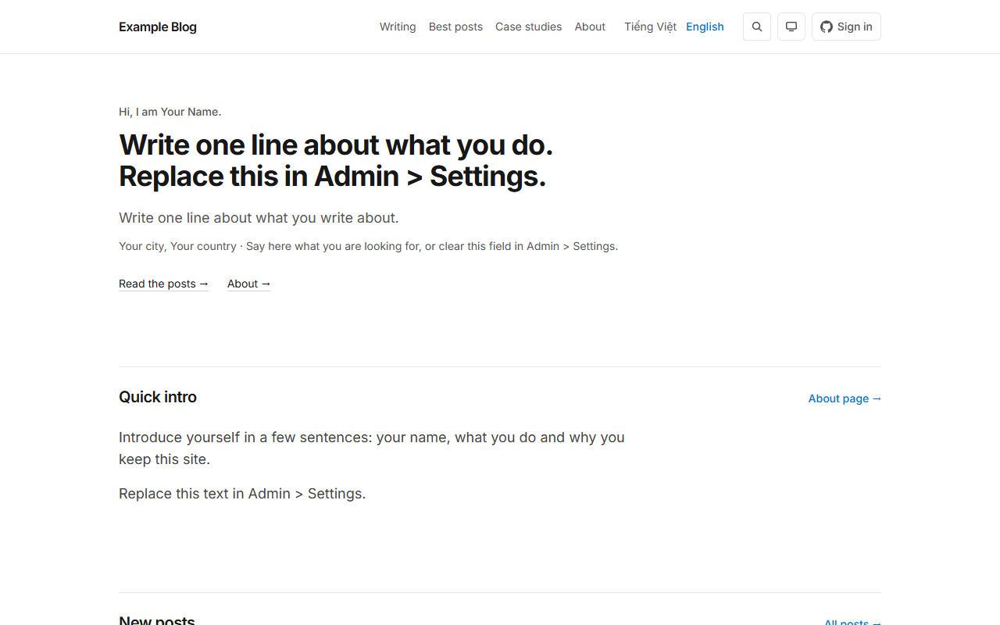
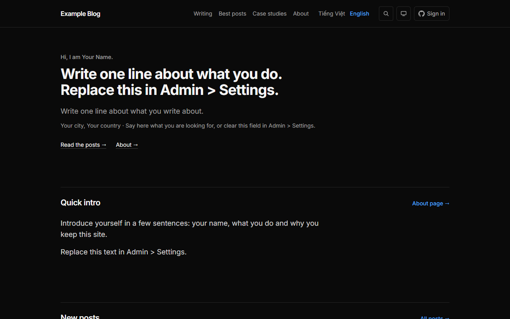
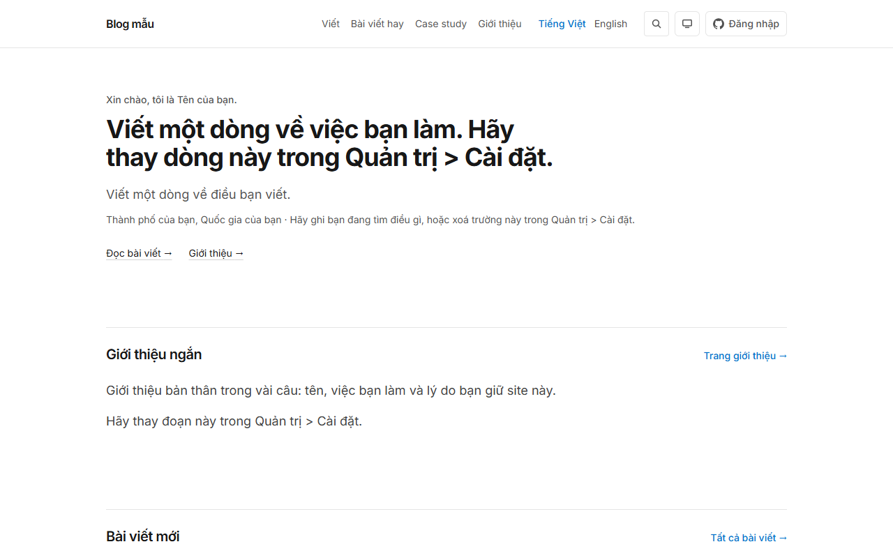
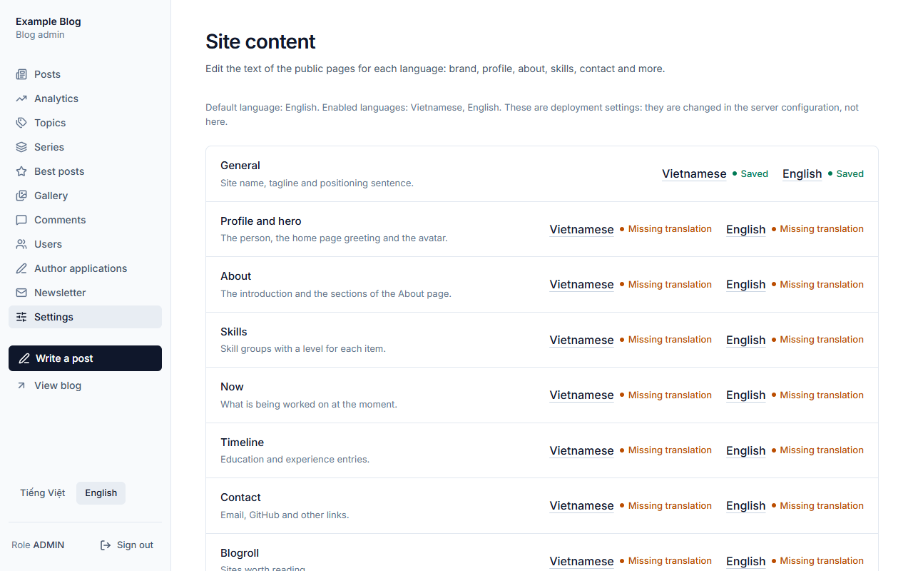

# Blog Engine

Một blog engine song ngữ (tiếng Anh và tiếng Việt), tự lưu trữ được: API Spring Boot, site Next.js và PostgreSQL, chạy bằng Docker
Compose trên một máy chủ nhỏ. Chủ site tự sửa mọi thông tin về mình (tên site, hồ sơ, giới thiệu, liên hệ) ngay trên trình duyệt,
theo từng ngôn ngữ; bài viết có thể viết bằng một trong hai ngôn ngữ và liên kết làm bản dịch của nhau. Độc giả có thể đăng nhập
bằng GitHub (không bắt buộc) để bình luận, thích và lưu bài, và ai cũng đăng ký được nhận bài qua email (newsletter).

Phiên bản `1.0.0-rc.1` (bản phát hành thử). README tiếng Anh: [README.md](README.md).

```
Trình duyệt -> Next.js (render trên máy chủ) -> Spring Boot REST API -> PostgreSQL
```

Trình duyệt không bao giờ gọi API trực tiếp: mọi yêu cầu tới backend đều do máy chủ Next gửi, và token đăng nhập nằm trong cookie
`httpOnly` trên origin của site, nên JavaScript phía client không đọc được và không cần cấu hình CORS.

## Ảnh chụp màn hình



Trang chủ, tiếng Anh, giao diện sáng. Khung nhìn và ngày chụp: 1280 x 800, 2026-10-11, chụp từ bản cài mới bằng Docker Compose với nội dung mẫu.



Trang chủ, tiếng Anh, giao diện tối. Khung nhìn và ngày chụp: 1280 x 800, 2026-10-11, chụp từ bản cài mới bằng Docker Compose với nội dung mẫu.



Trang chủ, tiếng Việt, giao diện sáng. Khung nhìn và ngày chụp: 1280 x 800, 2026-10-11, chụp từ bản cài mới bằng Docker Compose với nội dung mẫu.



Cài đặt quản trị (nội dung site theo từng ngôn ngữ), tiếng Anh. Khung nhìn và ngày chụp: 1280 x 800, 2026-10-11, chụp từ bản cài mới bằng Docker Compose với nội dung mẫu.

## Tính năng

- **Hai ngôn ngữ.** Giao diện tiếng Anh và tiếng Việt, cả trang công khai lẫn trang quản trị. Mỗi bài viết thuộc một ngôn ngữ và có
  thể liên kết với các bản dịch của nó; danh sách, tìm kiếm, feed và sitemap theo ngôn ngữ của trang, và liên kết `hreflang` chỉ
  có giữa các bản dịch đã đăng. Ngôn ngữ mặc định có URL không có tiền tố. Xem
  [docs/CONTENT-AND-I18N.md](docs/CONTENT-AND-I18N.md) (tiếng Anh).
- **Viết bài.** Bài viết Markdown render trên máy chủ, có tô màu cú pháp, ảnh bìa và ảnh trong bài, các phiên bản cũ (revision),
  series, chuyên mục và thẻ, danh sách "Bài viết hay" do chủ site chọn, thư viện ảnh, feed RSS, sitemap và dữ liệu có cấu trúc.
- **Nhập bài viết.** Quản trị viên và tác giả tải lên tối đa 20 tệp Markdown hoặc gói ZIP, xem thử rồi tạo các bài viết dưới dạng bản nháp (hoặc cập nhật bài của chính mình;
  quản trị viên cập nhật mọi bài), từ một tệp mẫu mà bạn có thể điền tay hoặc nhờ trợ lý AI ([docs/post-file-format.md](docs/post-file-format.md), tiếng Anh).
- **Các khối bài viết và soạn bài bằng AI.** Bài viết có thể dùng các khối có sẵn (hộp chú ý, hình có chú thích, bảng so sánh, sơ đồ Mermaid, các bước,
  thẻ mã nguồn, phần mở rộng, ...) và được nhập dưới dạng gói ZIP cùng ảnh của nó, do trợ lý AI viết theo lời nhắc soạn bài được tạo sẵn, rồi xem thử
  ngay trong trang bài viết thật ([docs/content-blocks.md](docs/content-blocks.md), [docs/ai-article-authoring.md](docs/ai-article-authoring.md), tiếng Anh).
- **Nội dung của chủ site nằm trong cơ sở dữ liệu.** Tên site, hồ sơ, giới thiệu, kỹ năng, dòng thời gian, liên hệ, blog nên đọc
  và case study được sửa ở `/admin/settings`, có lịch sử phiên bản, xuất và nhập JSON, và nhập hồ sơ từ tệp Markdown (tệp mẫu,
  xem thử, hoàn tác) mà bạn có thể điền tay hoặc nhờ trợ lý AI. Không có thông tin cá nhân nào nằm trong mã nguồn.
- **Độc giả (không bắt buộc).** Đăng nhập bằng GitHub, bình luận có trả lời, thích, lưu bài và thông báo.
- **Newsletter.** Xác nhận hai bước, mỗi bài đăng gửi một email, theo ngôn ngữ của người đăng ký. Gửi email thật cần một nhà cung
  cấp SMTP và chưa được các kiểm tra của chính dự án xác minh.
- **Quản trị.** Vai trò (độc giả, tác giả, quản trị viên), kiểm duyệt, tạm khoá người dùng, đơn xin làm tác giả, thống kê lượt xem
  tự thu thập không lưu địa chỉ IP hay user agent, thao tác hàng loạt trên bài viết.
- **Tìm kiếm.** Tìm kiếm toàn văn của PostgreSQL, không phân biệt hoa thường và dấu, hoặc Meilisearch (tuỳ chọn).
- **Tự lưu trữ.** Docker Compose cho máy chủ 2 GB, trang `/setup` ở lần chạy đầu thay cho mật khẩu mặc định, ví dụ Caddy và nginx
  có TLS, ảnh lưu trong PostgreSQL nên một lệnh `pg_dump` sao lưu được tất cả.

Danh sách đầy đủ ở [docs/FEATURES.md](docs/FEATURES.md).

## Bắt đầu nhanh

Bạn cần Docker có Compose v2 và một máy có ít nhất 2 GB RAM. Từ thư mục gốc của repository:

```bash
./scripts/init-env.sh                # trên Windows PowerShell: .\scripts\init-env.ps1
docker compose up -d --build
```

`init-env` ghi `.env` với các bí mật ngẫu nhiên và không ghi đè `.env` đã có. Lần build đầu mất vài phút. Sau đó mở
<http://localhost:3000/setup> và nhận quyền sở hữu site bằng mã thiết lập mà backend ghi vào một tệp:

```bash
docker compose exec backend sh -c 'cat /data/setup-code'
```

Ở `/setup` bạn chọn tên hiển thị, email và mật khẩu; rồi đăng nhập ở `/admin/login`, điền thông tin site ở Quản trị, Cài đặt, và
nếu muốn thì nạp nội dung mẫu ngay trên trang đó. Một site công khai cần tên miền, `SITE_URL=https://...` và một reverse proxy có
TLS: xem [docs/vi/INSTALL.md](docs/vi/INSTALL.md).

## Tài liệu

| Đọc | Để làm gì |
|---|---|
| [docs/vi/INSTALL.md](docs/vi/INSTALL.md) | Cài đặt bằng Compose, image dựng sẵn hoặc từ mã nguồn, TLS với Caddy hoặc nginx, đăng nhập GitHub, SMTP và tìm kiếm (tuỳ chọn). |
| [docs/vi/FIRST-RUN.md](docs/vi/FIRST-RUN.md) | Mã thiết lập, `/setup`, tên site và ngôn ngữ, nội dung mẫu, bài viết đầu tiên. |
| [docs/CONFIGURATION.md](docs/CONFIGURATION.md) | Mọi biến môi trường, build argument và thuộc tính tinh chỉnh (tiếng Anh). |
| [docs/CONTENT-AND-I18N.md](docs/CONTENT-AND-I18N.md) | Ngôn ngữ, URL, bản dịch, tìm kiếm và cách thêm một ngôn ngữ (tiếng Anh). |
| [docs/vi/ADMIN-GUIDE.md](docs/vi/ADMIN-GUIDE.md) | Cài đặt, nhập Markdown, bài viết và bản dịch, vai trò và quyền, newsletter. |
| [docs/UPGRADING.md](docs/UPGRADING.md) | Nâng cấp một site đang chạy (tiếng Anh). |
| [docs/BACKUP-AND-RESTORE.md](docs/BACKUP-AND-RESTORE.md) | Sao lưu và khôi phục (tiếng Anh). |
| [docs/TROUBLESHOOTING.md](docs/TROUBLESHOOTING.md) | Khi có gì đó không khởi động hoặc không chạy (tiếng Anh). |
| [docs/ARCHITECTURE.md](docs/ARCHITECTURE.md) | Mã nguồn được tổ chức thế nào (tiếng Anh). |
| [docs/SECURITY.md](docs/SECURITY.md) | Ghi chú về mối đe doạ và các quyết định bảo mật (tiếng Anh). |
| [docs/DEVELOPMENT.md](docs/DEVELOPMENT.md) | Chạy cục bộ, kiểm thử, E2E, CI (tiếng Anh). |
| [docs/ASSETS.md](docs/ASSETS.md) | Font, biểu tượng và tài nguyên khác cùng giấy phép của chúng (tiếng Anh). |
| [docs/site-profile-format.md](docs/site-profile-format.md) | Định dạng tệp hồ sơ Markdown. |
| [docs/post-file-format.md](docs/post-file-format.md) | Định dạng tệp bài viết Markdown và gói ZIP (tiếng Anh). |
| [docs/content-blocks.md](docs/content-blocks.md) | Các khối bài viết: cú pháp, thuộc tính, biến thể, khả năng truy cập (tiếng Anh). |
| [docs/ai-article-authoring.md](docs/ai-article-authoring.md) | Viết gói bài viết cùng trợ lý AI (tiếng Anh). |
| [docs/CONVENTIONS.md](docs/CONVENTIONS.md) | Quy ước viết mã và lý do đằng sau (tiếng Anh). |
| [CONTRIBUTING.md](CONTRIBUTING.md), [CODE_OF_CONDUCT.md](CODE_OF_CONDUCT.md), [SECURITY.md](SECURITY.md), [CHANGELOG.md](CHANGELOG.md) | Đóng góp, quy tắc ứng xử, cách báo lỗ hổng bảo mật, ghi chú phát hành (tiếng Anh). |

Bảng thuật ngữ giao diện: [docs/vi/glossary.md](docs/vi/glossary.md).

## Yêu cầu và công nghệ

Để chạy site: Docker Engine có plugin Compose, từ 2 GB RAM trở lên, và với một site công khai thì cần một tên miền với cổng 80 và
443 mở. Để phát triển: JDK 25, Node.js 22 (20.9 trở lên vẫn chạy được), Docker (PostgreSQL và Testcontainers) và Maven trong PATH;
xem [docs/DEVELOPMENT.md](docs/DEVELOPMENT.md).

| Thành phần | Công nghệ |
|---|---|
| Backend | Java 25, Spring Boot 4.1, Spring Security (JWT, Argon2id), Spring Data JPA, Flyway, Maven |
| Cơ sở dữ liệu | PostgreSQL 18 (có extension `unaccent`) |
| Frontend | Next.js 16 (App Router), React 19, TypeScript, Tailwind CSS 4, next-intl, Shiki |
| Tìm kiếm | Tìm kiếm toàn văn PostgreSQL; Meilisearch v1.54.3 (tuỳ chọn) |
| Chạy | Docker Compose; image backend cho `linux/amd64` và `linux/arm64` trên `ghcr.io`, frontend build từ bản checkout của bạn |
| Kiểm thử | JUnit và Testcontainers, Vitest, Playwright, ArchUnit |

## Giấy phép

Phát hành theo Giấy phép MIT, bản quyền HaAnhTun. Xem [LICENSE](LICENSE). Phần mềm bên thứ ba và giấy phép của chúng
được liệt kê trong `THIRD_PARTY_NOTICES.md` khi tệp đó được tạo cho một bản phát hành.
