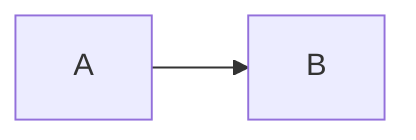

# Article blocks

An article body is Markdown plus a fixed library of native blocks: callouts, figures, galleries, side-by-side comparisons, comparison
tables, diagrams, numbered steps, code tabs, expandable details, key takeaways, checklists, pull quotes, file trees, timelines, metrics
and tabs. An author, or an AI assistant, chooses which blocks an article uses and in what order; the page around the article (header,
navigation, table of contents, footer) stays the site's. This page is the reference for the blocks. How to write a whole article for
the import, and the prompt to give an AI assistant, are in [ai-article-authoring.md](ai-article-authoring.md); the file format is in
[post-file-format.md](post-file-format.md).

The registry `frontend/lib/blocks/registry.ts` is the single source of truth. The reference below between the markers is generated from
it, and a test (`frontend/lib/blocks/content-blocks-doc.test.ts`) fails when the two differ: a block, an attribute, an allowed value, a
default or a limit added to the registry fails the test until this page says so. To refresh the block after a change to the registry run

```bash
cd frontend && UPDATE_BLOCK_DOCS=1 npx vitest run lib/blocks/content-blocks-doc.test.ts
```

and commit the result. The same text is part of the authoring prompt, so what a person reads here is what an AI is told.

## Syntax

```markdown
:::callout{type="warning" title="The hidden constraint"}
Markdown goes here, as in the rest of the article.
:::

::figure{src="assets/request-flow.png" alt="The request flow" caption="One request, end to end."}

:::::steps{title="Install"}
::::step{title="Download"}
Fetch the archive.
::::
::::step{title="Run"}
Start the server.
::::
:::::
```

- A block starts with a line `:::name{attributes}` and ends with a line that has the same number of colons. This is the container
  directive syntax of the `remark-directive` library.
- **Colons.** A block that contains other blocks needs more colons than the blocks inside it, at every level; with the same number the
  first closing line ends the outer block, so the inner block is left unclosed and the closing line meant for the outer block is stray (the
  import reports `unclosed-block` and `bad-fence`), and both blocks are then drawn as plain content. The number is computed from the registry (three, plus one for
  every level of container blocks the block may hold; a one-line block adds none) and printed in the "Colons" line of each block below:
  open and close the block with that many colons or more, which is enough for everything the block may hold. The example below the list
  shows `details` (6) around `steps` (5) around `step` (4) around `callout` (3).
- **Depth.** At most 8 blocks may be open at once, and at most 16 may be written behind a quote, a list marker or a footnote
  (`> :::note`), which is not supported anyway. A block may also not stay open across a very long run of lines (the sum, over the
  lines, of the blocks open at each may not pass 100 000: a single block over 100 000 lines, or 8 blocks over 12 000). An article that
  goes past either is not read for blocks at all: every block shows as plain text and the import and the editor preview report one
  `too-deep` problem. The parser takes much longer than the text grows when blocks are left open, so this keeps one article from
  holding up the server. The count errs on the high side: a line such as `:::a b` or a
  code sample that opens a block and never closes it counts as an open block. An article that closes its blocks never comes near the
  limit; the registry asks for four levels at most.
  Separately from the blocks, an article that asks the Markdown parser for too much work (thousands of quotes, of headings underlined with
  `---` or of HTML tags, a very long run of `*`, `_`, `[` or `]` characters in one paragraph (or tens of thousands of them, links and emphasis included, in the whole article), a word of tens of thousands of characters,
  thousands of web or e-mail addresses written out, of table cells or of colons in one stretch of text, unclosed `<!--` in a long paragraph,
  or more than about 5,000 non-blank lines) is shown as plain text, headings and links included, with one `too-heavy` problem. A code
  sample of hundreds of lines with brackets and underscores and no blank line in it counts too: split it into several code blocks.
  Syntax highlighting has limits of its own: a line of 300 characters or more, a block of about 375 lines or more, and everything past
  120,000 characters or 2,000 lines of code (or 1.5 s of highlighting) in one article are drawn as code without colour. The text is
  never dropped.
- A block with no body is written on one line with two colons: `::figure{...}`.
- Attribute values are text. Write them in double quotes when they contain spaces (`title="Two words"`). A flag, such as `open`, is
  written by its name alone. An attribute not in the table of its block is a problem, and so is a missing required attribute or a value
  outside the allowed ones. `class` and `id` are never attributes: an article cannot add CSS or anchors of its own.
- The body of a block is Markdown, with these exceptions: `diagram` keeps its source as written and does not read it as Markdown, and the
  blocks that hold other blocks, images, a table, a list or code fences accept only that (the "Body" line of each block says which). A
  Markdown body must not be empty; a diagram source goes directly under the opening line, without a code fence, and is at most 20,000
  characters; every item of a checklist is a task; the titles of code tabs differ from each other (ignoring letter case).
- A heading inside a block is a problem. Headings build the table of contents of the page, so write them between blocks. A line of text
  with a line of `---` or `===` directly under it is a heading to Markdown, so leave a blank line before a rule inside a block.
- Blocks that make sense only inside another block (`pane` inside `compare`, `step` inside `steps`) cannot stand alone.
- Text such as `10:30` or `Note:this` is not a block. Only a name at the start of a line, followed by attributes or a body, is read as
  one. In running text a colon directly followed by a name and `{` or `[` (`:name{x}`), or by the name of a block (`:steps`), is reported
  as a mistyped block, and so is a line that starts with two or more colons without being a block line; put such text in backticks.
- Do not put a double quote inside an attribute value: reword it.

Three levels of blocks, each opened and closed with its own number of colons:

````markdown
::::::details{title="Troubleshooting"}
Open this when the request fails.

:::::steps{title="Check in order"}
::::step{title="Read the status"}
Look at the status code first.

:::callout{type=tip title="Common cause"}
A status of 401 means the key is missing.
:::
::::
::::step{title="Try again"}
Send the request once more.
::::
:::::
::::::
````

Start every block at the left margin, on its own line, with a blank line before and after every block that stands in the text. In a block
that holds only other blocks the children follow each other directly. The importer also reads a block that directly follows a line of text
or another block, but write the blank lines. A block inside a list item, a quote or a table is a problem, also when it is
indented under a list item. The kind of a callout is its `type` attribute: there is no `:::note` or `:::warning`, and a label in square
brackets (`:::callout[Title]`) is not supported, so use `title`. A closing line of colons with nothing to close is a problem too.

A fenced code block may carry a title after its language: ` ```python title="server.py" `. It is drawn as a titled panel with the
copy button. A line highlight, ` ```yaml highlight="2,5-7" `, marks those lines with a border (lines and ranges in ascending order, at
most 40 of them, all inside the code; the lines are also named in text for screen readers). The twenty languages the site highlights are
`java`, `typescript` (`ts`), `tsx`, `javascript` (`js`), `python` (`py`), `bash` (`sh`), `sql`, `json`, `yaml` (`yml`), `xml`, `diff`,
`shellsession`, `go`, `rust`, `html`, `css`, `dockerfile`, `toml`, `markdown` and `ini`; any other label is shown as plain text, which is
not an error (`powershell` and `mermaid` are not in the list: write `text` and name the language in the title). A `diff` fence colours
added and removed lines, keeps the `+` and `-` in the text and also takes context lines and `@@` hunk headers. The numbers of `highlight`
count from 1 on the first line of the code inside the fence. A `#` comment line, a TOML section line such as `[rules]` and a diff context
line inside a fence are never headings, also inside a block. A `shellsession` fence is a terminal session: prompt lines start with `$ `
and the output follows without it.

## What happens to a mistake

Nothing is lost silently. A block that does not pass the registry (an unknown name, a bad or missing attribute, a bad nesting, a heading
inside, a block that is never closed, a lookalike such as a stray `<ai-block>` tag) is drawn as its inner Markdown, so the reader still
sees the content, and it is listed as a **problem**: a 1-based line number and a message that names the block and the supported
alternatives. Where the problems show:

- the import page lists them on the card of the file, and a file with a problem cannot be ticked;
- the article preview of the import page, the editor preview and the "Check before publishing" panel of the post editor list them;
- the public page never shows them, it shows the plain content.

`validateBlocks(markdown)` in `frontend/lib/blocks/validate.ts` is the one function behind all of them.

## Common mistakes

The authoring prompt carries the same list. Every wrong example below is run through `validateBlocks` by a test and must be reported with
the problem it implies; every right example must pass. The list is generated from the code (`PITFALLS` in
`frontend/lib/blocks/authoring-prompt.ts`) with the rest of the reference.

<!-- BEGIN PITFALLS -->
**A kind of callout written as a block.** Wrong:

`````markdown
:::note
Back up the database first.
:::
`````

Right:

`````markdown
:::callout{type=note}
Back up the database first.
:::
`````

**A label in square brackets.** Wrong:

`````markdown
:::callout[Heads up]
Check the version.
:::
`````

Right:

`````markdown
:::callout{title="Heads up"}
Check the version.
:::
`````

**The same number of colons around a block and the block inside it.** Wrong:

`````markdown
:::steps
:::step{title="Install"}
Run the installer.
:::
:::
`````

Right:

`````markdown
:::::steps
::::step{title="Install"}
Run the installer.
::::
:::::
`````

**A block inside a list.** Wrong:

`````markdown
- Install the client

  :::callout{type=tip}
  Use the latest version.
  :::
`````

Right:

`````markdown
- Install the client

:::callout{type=tip}
Use the latest version.
:::
`````

**A heading inside a block.** Wrong:

`````markdown
:::callout
## Notes
Text.
:::
`````

Right:

`````markdown
## Notes

:::callout
Text.
:::
`````

**A diagram wrapped in a code fence.** Wrong:

`````markdown
:::diagram{type=mermaid alt="A goes to B"}

:::
`````

Right:

`````markdown
:::diagram{type=mermaid alt="A goes to B"}
flowchart LR
  A --> B
:::
`````

**Plain bullets in a checklist.** Wrong:

`````markdown
:::checklist
- Back up the data
- [ ] Run the migration
:::
`````

Right:

`````markdown
:::checklist
- [ ] Back up the data
- [ ] Run the migration
:::
`````

**Two code tabs with the same title.** Wrong:

`````markdown
:::code-tabs
```bash title="Install"
npm install
```
```bash title="install"
npm ci
```
:::
`````

Right:

`````markdown
:::code-tabs
```bash title="npm"
npm install
```
```bash title="pnpm"
pnpm install
```
:::
`````

**Text that looks like a block.** Wrong:

`````markdown
Use :callout{type=note} for asides.
`````

Right:

`````markdown
Use `:callout{type=note}` for asides.
`````

**A closing line with nothing to close.** Wrong:

`````markdown
Text.

:::callout
Note.
:::
:::
`````

Right:

`````markdown
Text.

:::callout
Note.
:::
`````

**An image without alternative text.** Wrong:

`````markdown
::figure{src="assets/a.png" alt=""}
`````

Right:

`````markdown
::figure{src="assets/a.png" alt="A terminal that shows the answer"}
`````
<!-- END PITFALLS -->

## Where blocks render

There is one pipeline: `renderMarkdown` in `frontend/lib/markdown.tsx`. The public post page, the admin preview, the editor preview and
the import's article preview all call it, so a block looks the same everywhere. The chain is `remark-parse`, GFM, `remark-directive`,
the block step (validates against the registry, turns each valid block into an `ai-block` element with validated attributes), then
`remark-rehype`, `rehype-raw` and `rehype-sanitize`. The sanitize schema gains the `ai-block` tag with the attribute names of the
registry and nothing else; a dispatcher checks every attribute against the registry once more before it draws the native component, so
hand-written HTML cannot do more than a block can. No HTML, CSS or script of an article is ever executed.

- **Feeds.** The RSS and Atom feeds receive plain HTML: a callout becomes a blockquote, a figure a `figure` and `img`, details stay
  `details`, a diagram becomes a code block of language `mermaid`, steps an ordered list, panes a sequence of sections, a comparison its
  table, code tabs titled code blocks.
- **Search and reading time.** The marker lines (`:::name{...}` and `:::`) and the source of a diagram are left out of the search text
  and of the reading time; the words inside a block count.
- **Width.** Blocks are width-agnostic. They fill the article column of the page, lay themselves out with container queries (a
  comparison is side by side when the column is wide and stacked when it is narrow), and never set a fixed pixel width or break out of
  the column. A variant such as `wide` means the whole width of the article column, never wider. The frame of the page (the header, the
  columns and the rails) belongs to the page shell.
- **Themes.** Every block has light and dark styles through the site's `dark:` variant, and respects reduced motion.
- **Diagrams.** The `mermaid` library is loaded in the browser only, lazily, with its strictest security level, and only by a page that
  holds a diagram. Before it loads, when JavaScript is off and when a diagram cannot be drawn, the source shows as preformatted text.
  Keep a diagram short and plain: `flowchart`, `sequenceDiagram`, `classDiagram`, `stateDiagram-v2` or `erDiagram`, with no HTML in
  labels, no `click` lines and no `%%{init}%%` settings (the strict security level switches interactions off, and raw HTML in labels is escaped); `alt` is the accessible name of the
  drawing. A diagram that Mermaid cannot read is not an import error: the page shows its source as text.
- **Images.** A `figure` or a gallery image is a normal body image: lazy, with the size from the `#WxH` hint when the importer wrote one.
  After an import of a package the paths are `/media/...` paths of images stored with the post.

## Block reference

<!-- BEGIN BLOCKS -->
| Block | Form | Where | Variants | May contain |
| --- | --- | --- | --- | --- |
| [`callout`](#callout) | container | anywhere | `compact`, `prominent` |  |
| [`figure`](#figure) | either | anywhere | `standard`, `wide` |  |
| [`gallery`](#gallery) | container | anywhere |  |  |
| [`compare`](#compare) | container | anywhere | `columns`, `before-after` | `pane` |
| [`pane`](#pane) | container | inside `compare` |  | `figure`, `callout` |
| [`comparison`](#comparison) | container | anywhere |  |  |
| [`diagram`](#diagram) | container | anywhere |  |  |
| [`steps`](#steps) | container | anywhere | `sequential`, `grouped` | `step` |
| [`step`](#step) | container | inside `steps` |  | `callout`, `figure`, `gallery`, `diagram`, `code-tabs`, `comparison`, `file-tree` |
| [`code-tabs`](#code-tabs) | container | anywhere |  |  |
| [`details`](#details) | container | anywhere | `inline`, `appendix` | `callout`, `figure`, `gallery`, `comparison`, `diagram`, `code-tabs`, `steps`, `checklist`, `takeaways`, `file-tree` |
| [`takeaways`](#takeaways) | container | anywhere |  |  |
| [`checklist`](#checklist) | container | anywhere |  |  |
| [`pullquote`](#pullquote) | container | anywhere |  |  |
| [`file-tree`](#file-tree) | container | anywhere |  |  |
| [`timeline`](#timeline) | container | anywhere |  | `event` |
| [`event`](#event) | container | inside `timeline` |  | `callout`, `figure`, `code-tabs` |
| [`metrics`](#metrics) | container | anywhere |  | `metric` |
| [`metric`](#metric) | leaf | inside `metrics` |  |  |
| [`tabs`](#tabs) | container | anywhere |  | `tab` |
| [`tab`](#tab) | container | inside `tabs` |  | `callout`, `figure`, `code-tabs`, `steps`, `file-tree` |

### `callout`

A short aside set apart from the text: a note, a tip, a warning. Use it sparingly, only where it helps the reader.

- Form: container (a line of colons and the name opens it, a line of the same number of colons closes it).
- Syntax:

  ```markdown
  :::callout{[type=info] [title="..."] [variant=compact]}
  ...
  :::
  ```

- Colons: 3 or more, the same number on the opening and the closing line.
- Body: Markdown without headings: paragraphs, lists, code, images, tables. The body must not be empty.
- Contains no other blocks.
- Variants (attribute `variant`): `compact`, `prominent`.
- Accessibility: A note landmark. The kind of callout is announced as a text label as well as shown by icon and color.

| Attribute | Required | Value | Default | Meaning |
| --- | --- | --- | --- | --- |
| `type` | no | info or note or tip or warning or danger | `info` | What kind of aside this is. The kind is also written out as text, never shown by color alone. |
| `title` | no | text, up to 120 characters |  | An optional short heading for the callout. |
| `variant` | no | compact or prominent | `compact` | Compact for a short aside, prominent for a warning the reader must not miss. |

### `figure`

An image with alternative text, an optional caption and an optional attribution. Written on one line: ::figure{src="..." alt="..."}.

- Form: leaf (one line: ::name{...}); a container with an empty body is accepted too.
- Syntax:

  ```markdown
  ::figure{src="assets/image.png" alt="..." [caption="..."] [attribution="..."] [variant=standard]}
  ```

- Colons: two, written on one line.
- Body: No body: it is written on one line.
- Variants (attribute `variant`): `standard`, `wide`.
- Accessibility: A figure with a figcaption. The alternative text is required; images load lazily and keep their size so the text does not jump.

| Attribute | Required | Value | Default | Meaning |
| --- | --- | --- | --- | --- |
| `src` | yes | image path or URL, up to 500 characters |  | The image: a path inside the package such as assets/diagram.png, a /media/ path, or an https URL. |
| `alt` | yes | text, up to 300 characters |  | What the image shows, for readers who cannot see it. |
| `caption` | no | text, up to 400 characters |  | What the reader should take from the image. |
| `attribution` | no | text, up to 200 characters |  | Who made the image, when it is not the author. |
| `variant` | no | standard or wide | `standard` | Wide uses the whole width of the article body; it never goes wider than that. |

### `gallery`

A grid of images. The body is Markdown images only, one per line, each with alternative text.

- Form: container (a line of colons and the name opens it, a line of the same number of colons closes it).
- Syntax:

  ```markdown
  :::gallery{[columns=2] [caption="..."]}
  ...
  :::
  ```

- Colons: 3 or more, the same number on the opening and the closing line.
- Body: Markdown images only, one per line, each with alternative text. Number of items: 2 to 12.
- Contains no other blocks.
- Accessibility: A list of figures. Every image needs alternative text; there is no lightbox to trap focus.

| Attribute | Required | Value | Default | Meaning |
| --- | --- | --- | --- | --- |
| `columns` | no | whole number 2 to 3 | `2` | How many images sit side by side when there is room; one column when the article is narrow. |
| `caption` | no | text, up to 300 characters |  | A caption for the whole gallery. |

### `compare`

Two or three panes side by side, stacked when the article is narrow. Each pane is a pane block.

- Form: container (a line of colons and the name opens it, a line of the same number of colons closes it).
- Syntax:

  ```markdown
  :::::compare{[variant=columns]}
  ...
  :::::
  ```

- Colons: 5 or more, the same number on the opening and the closing line.
- Body: Only blocks of the types listed under "Contains". Number of items: 2 to 3. With variant "before-after": at most 2.
- Contains: `pane`.
- Variants (attribute `variant`): `columns`, `before-after`.
- Accessibility: Each pane is a labelled group, so the order and the titles are read out in sequence.

| Attribute | Required | Value | Default | Meaning |
| --- | --- | --- | --- | --- |
| `variant` | no | columns or before-after | `columns` | Columns for two or three alternatives, before-after for exactly two states of the same thing. |

### `pane`

One pane of a compare block: text, code or images. Only valid directly inside the compare block.

- Form: container (a line of colons and the name opens it, a line of the same number of colons closes it).
- Syntax:

  ```markdown
  ::::pane{title="..."}
  ...
  ::::
  ```

- Colons: 4 or more, the same number on the opening and the closing line.
- Body: Markdown without headings: paragraphs, lists, code, images, tables. The body must not be empty.
- May also contain these blocks: `figure`, `callout`.
- Only valid directly inside `compare`.
- Accessibility: A labelled group named by its title.

| Attribute | Required | Value | Default | Meaning |
| --- | --- | --- | --- | --- |
| `title` | yes | text, up to 120 characters |  | The label of the pane, such as Before or Option A. |

### `comparison`

A titled panel around a Markdown table, for comparing options across several criteria.

- Form: container (a line of colons and the name opens it, a line of the same number of colons closes it).
- Syntax:

  ```markdown
  :::comparison{[title="..."] [caption="..."]}
  ...
  :::
  ```

- Colons: 3 or more, the same number on the opening and the closing line.
- Body: Markdown that holds at least one table.
- Contains no other blocks.
- Accessibility: The table keeps its header cells and its keyboard-focusable scroll region on narrow screens.

| Attribute | Required | Value | Default | Meaning |
| --- | --- | --- | --- | --- |
| `title` | no | text, up to 120 characters |  | A heading for the table panel. |
| `caption` | no | text, up to 300 characters |  | A sentence under the table. |

### `diagram`

A diagram written as Mermaid source in the body. The body is kept exactly as written and is not read as Markdown.

- Form: container (a line of colons and the name opens it, a line of the same number of colons closes it).
- Syntax:

  ```markdown
  :::diagram{type=mermaid [title="..."] [caption="..."] [alt="..."]}
  ...
  :::
  ```

- Colons: 3 or more, the same number on the opening and the closing line.
- Body: The raw source text, written directly under the opening line without a code fence and kept exactly as written. It is not parsed as Markdown. It must not be empty and is at most 20,000 characters.
- Contains no other blocks.
- Accessibility: Drawn in the browser. Before that, and when it cannot be drawn, the source shows as preformatted text; the drawing is an image named by alt.

| Attribute | Required | Value | Default | Meaning |
| --- | --- | --- | --- | --- |
| `type` | yes | mermaid |  | The diagram language. Only mermaid is supported. |
| `title` | no | text, up to 120 characters |  | A heading for the diagram. |
| `caption` | no | text, up to 300 characters |  | A sentence under the diagram. |
| `alt` | no | text, up to 300 characters |  | What the diagram shows, used as its accessible name. |

### `steps`

A numbered procedure. A block that holds other blocks uses more colons than the blocks inside it; the Colons line below gives the number.

- Form: container (a line of colons and the name opens it, a line of the same number of colons closes it).
- Syntax:

  ```markdown
  :::::steps{[title="..."] [variant=sequential]}
  ...
  :::::
  ```

- Colons: 5 or more, the same number on the opening and the closing line.
- Body: Only blocks of the types listed under "Contains". Number of items: at least 1.
- Contains: `step`.
- Variants (attribute `variant`): `sequential`, `grouped`.
- Accessibility: An ordered list; the numbers are real list numbers, not decoration.

| Attribute | Required | Value | Default | Meaning |
| --- | --- | --- | --- | --- |
| `title` | no | text, up to 120 characters |  | A heading for the procedure. |
| `variant` | no | sequential or grouped | `sequential` | Sequential numbers every step in a line, grouped sets each step in its own panel. |

### `step`

One step of a steps block: a title and optional text, code or images. Only valid directly inside the steps block.

- Form: container (a line of colons and the name opens it, a line of the same number of colons closes it).
- Syntax:

  ```markdown
  ::::step{title="..."}
  ...
  ::::
  ```

- Colons: 4 or more, the same number on the opening and the closing line.
- Body: Markdown without headings. The body may be empty.
- May also contain these blocks: `callout`, `figure`, `gallery`, `diagram`, `code-tabs`, `comparison`, `file-tree`.
- Only valid directly inside `steps`.
- Accessibility: A list item whose number is announced by the list.

| Attribute | Required | Value | Default | Meaning |
| --- | --- | --- | --- | --- |
| `title` | yes | text, up to 120 characters |  | The one-line name of the step. |

### `code-tabs`

The same thing in several languages or files. The body is fenced code blocks only, each with title="Label" after the language.

- Form: container (a line of colons and the name opens it, a line of the same number of colons closes it).
- Syntax:

  ```markdown
  :::code-tabs{[title="..."]}
  ...
  :::
  ```

- Colons: 3 or more, the same number on the opening and the closing line.
- Body: Fenced code blocks only, each with a title="Label" after the language. The titles must be different from each other (ignoring letter case) and at most 120 characters. There must be no text between the fences. Number of items: 2 to 8.
- Contains no other blocks.
- Accessibility: The WAI-ARIA tabs pattern: arrow keys, Home and End move between tabs, every panel stays in the document.

| Attribute | Required | Value | Default | Meaning |
| --- | --- | --- | --- | --- |
| `title` | no | text, up to 120 characters |  | A heading for the group of tabs. |

### `details`

Expandable details: troubleshooting, background, an appendix. Collapsed by default.

- Form: container (a line of colons and the name opens it, a line of the same number of colons closes it).
- Syntax:

  ```markdown
  ::::::details{title="..." [open] [variant=inline] [group="..."]}
  ...
  ::::::
  ```

- Colons: 6 or more, the same number on the opening and the closing line.
- Body: Markdown without headings: paragraphs, lists, code, images, tables. The body must not be empty.
- May also contain these blocks: `callout`, `figure`, `gallery`, `comparison`, `diagram`, `code-tabs`, `steps`, `checklist`, `takeaways`, `file-tree`.
- Variants (attribute `variant`): `inline`, `appendix`.
- Accessibility: A native details element with a summary: operable by keyboard, with a visible focus ring.

| Attribute | Required | Value | Default | Meaning |
| --- | --- | --- | --- | --- |
| `title` | yes | text, up to 120 characters |  | The always-visible summary line. |
| `open` | no | flag | `false` | Open when the page loads. Written as a bare flag: {open}. |
| `variant` | no | inline or appendix | `inline` | Inline for a detail inside the flow of the text, appendix for material the reader can skip. |
| `group` | no | text, up to 40 characters |  | Details blocks with the same group open one at a time, like an FAQ accordion. |

### `takeaways`

The key points of the article. The body is a Markdown list.

- Form: container (a line of colons and the name opens it, a line of the same number of colons closes it).
- Syntax:

  ```markdown
  :::takeaways{[title="..."]}
  ...
  :::
  ```

- Colons: 3 or more, the same number on the opening and the closing line.
- Body: Markdown that holds a list.
- Contains no other blocks.
- Accessibility: A list inside a labelled group.

| Attribute | Required | Value | Default | Meaning |
| --- | --- | --- | --- | --- |
| `title` | no | text, up to 120 characters |  | A heading for the list. |

### `checklist`

A read-only checklist. The body is a Markdown task list: - [ ] item and - [x] item.

- Form: container (a line of colons and the name opens it, a line of the same number of colons closes it).
- Syntax:

  ```markdown
  :::checklist{[title="..."]}
  ...
  :::
  ```

- Colons: 3 or more, the same number on the opening and the closing line.
- Body: Markdown that holds a task list: lines starting with "- [ ]" or "- [x]". Every item must be a task; a plain bullet is an error.
- Contains no other blocks.
- Accessibility: A list whose items state whether they are checked, as text as well as by symbol. The reader cannot change them.

| Attribute | Required | Value | Default | Meaning |
| --- | --- | --- | --- | --- |
| `title` | no | text, up to 120 characters |  | A heading for the checklist. |

### `pullquote`

A short quotation set large. Use it for a line worth remembering, not to decorate the page.

- Form: container (a line of colons and the name opens it, a line of the same number of colons closes it).
- Syntax:

  ```markdown
  :::pullquote{[attribution="..."]}
  ...
  :::
  ```

- Colons: 3 or more, the same number on the opening and the closing line.
- Body: Markdown without headings: paragraphs, lists, code, images, tables. The body must not be empty.
- Contains no other blocks.
- Accessibility: A blockquote; the attribution is part of the quote, not a separate caption.

| Attribute | Required | Value | Default | Meaning |
| --- | --- | --- | --- | --- |
| `attribution` | no | text, up to 200 characters |  | Who said it. |

### `file-tree`

A directory structure as a nested Markdown list. Folders end with a slash.

- Form: container (a line of colons and the name opens it, a line of the same number of colons closes it).
- Syntax:

  ```markdown
  :::file-tree{[title="..."]}
  ...
  :::
  ```

- Colons: 3 or more, the same number on the opening and the closing line.
- Body: Markdown that holds a list.
- Contains no other blocks.
- Accessibility: A nested list, so depth is announced. Folders are told apart by the trailing slash in the text, not by an icon.

| Attribute | Required | Value | Default | Meaning |
| --- | --- | --- | --- | --- |
| `title` | no | text, up to 120 characters |  | A heading for the tree. |

### `timeline`

Dated or phased events in order: an incident, a release history.

- Form: container (a line of colons and the name opens it, a line of the same number of colons closes it).
- Syntax:

  ```markdown
  :::::timeline{[title="..."]}
  ...
  :::::
  ```

- Colons: 5 or more, the same number on the opening and the closing line.
- Body: Only blocks of the types listed under "Contains". Number of items: 2 to 20.
- Contains: `event`.
- Accessibility: An ordered list. Each event starts with its date or label as text.

| Attribute | Required | Value | Default | Meaning |
| --- | --- | --- | --- | --- |
| `title` | no | text, up to 120 characters |  | A heading for the timeline. |

### `event`

One event of a timeline. Only valid directly inside the timeline block.

- Form: container (a line of colons and the name opens it, a line of the same number of colons closes it).
- Syntax:

  ```markdown
  ::::event{title="..." when="..."}
  ...
  ::::
  ```

- Colons: 4 or more, the same number on the opening and the closing line.
- Body: Markdown without headings. The body may be empty.
- May also contain these blocks: `callout`, `figure`, `code-tabs`.
- Only valid directly inside `timeline`.
- Accessibility: A list item that leads with its label as plain text.

| Attribute | Required | Value | Default | Meaning |
| --- | --- | --- | --- | --- |
| `title` | yes | text, up to 120 characters |  | The one-line name of the event. |
| `when` | yes | text, up to 40 characters |  | The date or phase, such as 2025-03-02 or Phase 2. |

### `metrics`

Key figures side by side, for a benchmark or a case study. Written with one-line metric blocks.

- Form: container (a line of colons and the name opens it, a line of the same number of colons closes it).
- Syntax:

  ```markdown
  :::metrics{[title="..."] [caption="..."]}
  ...
  :::
  ```

- Colons: 3 or more, the same number on the opening and the closing line.
- Body: Only blocks of the types listed under "Contains". Number of items: 2 to 6.
- Contains: `metric`.
- Accessibility: A list of figures. Each reads as label, value, trend and note, in words.

| Attribute | Required | Value | Default | Meaning |
| --- | --- | --- | --- | --- |
| `title` | no | text, up to 120 characters |  | A heading for the figures. |
| `caption` | no | text, up to 300 characters |  | Where the figures come from. |

### `metric`

One figure of a metrics block. Written on one line: ::metric{label="p95" value="38 ms"}.

- Form: leaf (one line: ::name{...}).
- Syntax:

  ```markdown
  ::metric{label="..." value="..." [trend=up] [note="..."]}
  ```

- Colons: two, written on one line.
- Body: No body: it is written on one line.
- Only valid directly inside `metrics`.
- Accessibility: A list item. The trend is a text label from the catalog plus an arrow shape, never colour alone.

| Attribute | Required | Value | Default | Meaning |
| --- | --- | --- | --- | --- |
| `label` | yes | text, up to 60 characters |  | What is measured. |
| `value` | yes | text, up to 40 characters |  | The figure with its unit, such as 38 ms. |
| `trend` | no | up or down or flat |  | Direction of change, written out as text. It says which way the figure moved, never whether that is good or bad. |
| `note` | no | text, up to 120 characters |  | A short remark, such as the baseline. |

### `tabs`

The same task for different setups, such as macOS, Linux and Windows. Each tab holds text, code or images.

- Form: container (a line of colons and the name opens it, a line of the same number of colons closes it).
- Syntax:

  ```markdown
  :::::::tabs{[title="..."]}
  ...
  :::::::
  ```

- Colons: 7 or more, the same number on the opening and the closing line.
- Body: Only blocks of the types listed under "Contains". Number of items: 2 to 6. Each item needs its own title (ignoring letter case).
- Contains: `tab`.
- Accessibility: The WAI-ARIA tabs pattern: arrow keys, Home and End. Every panel stays in the document.

| Attribute | Required | Value | Default | Meaning |
| --- | --- | --- | --- | --- |
| `title` | no | text, up to 120 characters |  | A heading for the tabs. |

### `tab`

One tab of a tabs block. Only valid directly inside the tabs block.

- Form: container (a line of colons and the name opens it, a line of the same number of colons closes it).
- Syntax:

  ```markdown
  ::::::tab{title="..."}
  ...
  ::::::
  ```

- Colons: 6 or more, the same number on the opening and the closing line.
- Body: Markdown without headings: paragraphs, lists, code, images, tables. The body must not be empty.
- May also contain these blocks: `callout`, `figure`, `code-tabs`, `steps`, `file-tree`.
- Only valid directly inside `tabs`.
- Accessibility: A tab panel named by its tab.

| Attribute | Required | Value | Default | Meaning |
| --- | --- | --- | --- | --- |
| `title` | yes | text, up to 40 characters |  | The tab label. |
<!-- END BLOCKS -->

## Adding a block

A block is a registry entry plus a component, and both are tested (`docs/CONVENTIONS.md`, section 7).

1. Add the entry to `BLOCKS` in `frontend/lib/blocks/registry.ts`: type, form, attributes with their limits and defaults, variants,
   allowed children, body rule, an English description and the accessibility notes. Attributes get their TypeScript types from the entry.
2. Add the component `components/site/blocks/<PascalCase>.tsx` and list it in `BLOCK_COMPONENTS` in `components/site/blocks/index.ts`.
   Use `not-prose`, `w-full min-w-0 max-w-full`, container queries and `dark:` utilities; add no global CSS.
3. Add the labels the block shows to `frontend/messages/en.json` and `vi.json` (`Site.blocks`).
4. Give it a feed rendering in `frontend/lib/blocks/hast.ts` when plain HTML needs more than the block's children.
5. Add component tests (render, attributes, invalid attributes, dark classes, keyboard behavior) and run
   `UPDATE_BLOCK_DOCS=1 npx vitest run lib/blocks/content-blocks-doc.test.ts` to refresh this page. The authoring prompt follows the
   registry on its own.

## Known limits

- Mermaid is the only diagram language. An image can be used instead (`figure`).
- Only JPEG, PNG and WebP images are accepted in a package; SVG is refused.
- There is no lightbox for galleries, and a checklist is read-only.
- A block cannot hold a heading, so a section that should appear in the table of contents sits between blocks.
- Blocks nest only as the "May contain" column says. A callout cannot hold a block, for example.
- The default PostgreSQL search still indexes the marker lines and diagram sources of a body (the Meilisearch text and the reading time
  leave them out); fixing that is a new migration, not an edit of V23.
- An article is checked in the browser code (`validateBlocks`); the backend validates the archive, the images and unsafe content but does
  not parse blocks, so a package with a block problem is reported by the import page and not by the API alone.
