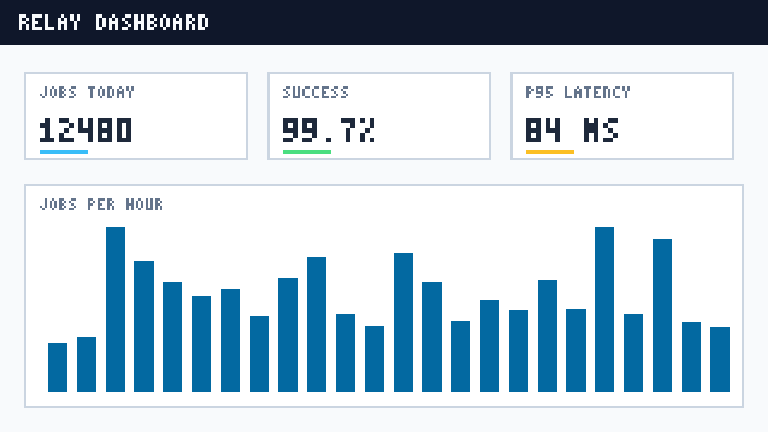
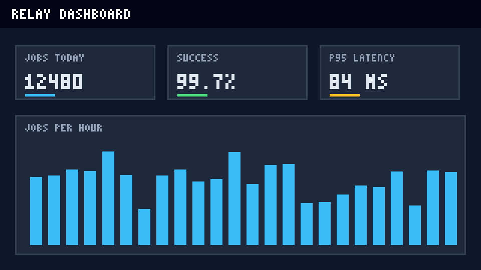

This tutorial takes you from an empty folder to a running Relay project. Relay is a made-up job queue, so nothing here touches a real service. It should take about ten minutes.

## Before you start

You need a few things on your machine. Tick them off as you go; the list is only a reminder, so nothing is saved.

:::checklist{title="Prerequisites"}
- [x] Node.js 20 or later
- [x] A terminal you are comfortable with
- [ ] A folder for the project
- [ ] About ten minutes
:::

:::callout{type="tip" title="Work in a scratch folder"}
Everything below is safe to repeat. If a step goes wrong, delete the folder and start again.
:::

## The four steps

:::::steps{title="From nothing to a running queue"}
::::step{title="Install the command line tool"}
Install the package globally with your package manager, then check the version.

:::code-tabs
```bash title="npm"
npm install --global relay-cli
relay --version
```

```bash title="pnpm"
pnpm add --global relay-cli
relay --version
```
:::

You should see a version number, as in the screenshot.

::figure{src="assets/step-1-install.png" alt="A terminal that shows the install command, a line saying 42 packages were added, and the version number 2.4.0." caption="The install and the version check."}
::::

::::step{title="Create the project"}
Run the initializer in your folder and answer the single question.

```bash
relay init
```

It creates a file named `relay.config.json` next to where you ran it.
::::

::::step{title="Edit the configuration"}
Open the file in your editor and set the region and the retry policy. The defaults are sensible; change them only if you know why.

::figure{src="assets/step-2-config.png" alt="An editor showing relay.config.json with a name, a region and a queue section with retries and a timeout." caption="A small configuration file."}

```json title="relay.config.json"
{
  "name": "demo",
  "region": "eu",
  "queue": {
    "retries": 5,
    "timeout": 30
  }
}
```
::::

::::step{title="Start it and send a job"}
Start the local service, and in a second terminal send a first job.

```bash
relay start
relay send --payload '{"hello": "world"}'
```

Open the dashboard at the address `relay start` prints. It should look like one of these two pictures, depending on your theme.

:::gallery{columns=2 caption="The dashboard after the first job, in the light and dark themes."}



:::
::::
:::::

## When something goes wrong

Two problems account for nearly every failed first run.

:::details{title="The command is not found after installing" open}
Your package manager installed it to a folder that is not on your path. Print the folder with `npm config get prefix`, add its `bin` subfolder to your path and open a new terminal.
:::

:::details{title="The dashboard shows no jobs"}
The service and the sender must use the same project. Run `relay send` from the folder that holds `relay.config.json`, or pass `--project` with its path.
:::

## Where to go next

You now have a queue that accepts jobs on your machine. Read the configuration reference to learn about retries, and add a worker for the job type you care about.
