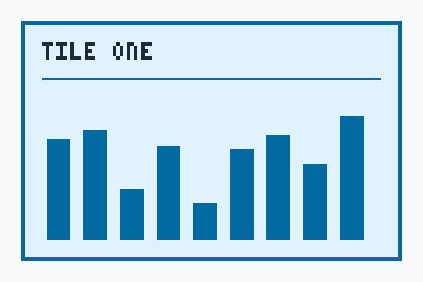
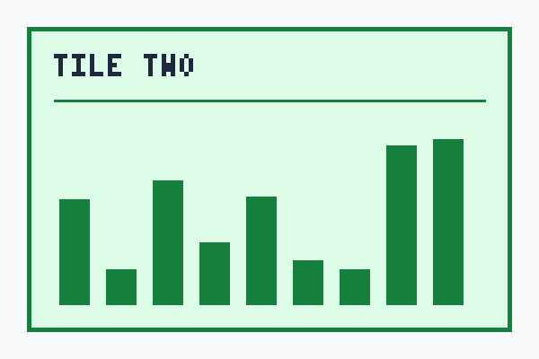
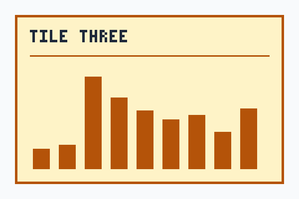

This page exists to draw the variants that the other example articles leave out. Relay is a made-up job queue, so nothing here describes a real product. Read it next to the other examples to see the same page shell hold a very different composition.

## Callouts of every kind

A note is a quiet aside, set in the compact variant.

:::callout{type="note" variant="compact" title="A note on naming"}
Relay calls a unit of work a job and a group of jobs a batch. The names stay the same in the interface, the logs and this page.
:::

A danger callout is for the one thing that loses data. The kind is written out as a label, so the warning does not depend on its color.

:::callout{type="danger" title="Never run the purge command on a live queue"}
The purge command deletes every waiting job and **cannot be undone**. Pause the workers first, export the queue, and ask a second person to read the command before you press enter.
:::

A prominent callout is for something the reader must see before going on, even when they skim.

:::callout{type="info" variant="prominent" title="Read this before the steps below"}
The procedure below changes the signing key that every worker uses. Plan it for a quiet hour and keep the old key until the last step is done.
:::

A callout has to survive text that does not break. This one holds a very long word and a very long address, and neither may push the page sideways.

:::callout{type="tip" title="Paste long names exactly as written"}
The setting is called Pneumonoultramicroscopicsilicovolcanoconiosis_Pneumonoultramicroscopicsilicovolcanoconiosis in the old files, and the reference lives at https://docs.example.com/relay/reference/configuration/queue/retries/backoff/exponential/maximum-delay-in-milliseconds-before-the-job-is-moved-to-the-dead-letter-queue-and-the-operator-is-notified for anyone who needs it.
:::

## A grouped procedure

Grouped steps set each step in its own panel, which suits a procedure whose steps are long and independent.

:::::steps{variant="grouped" title="Rotate the signing key"}
:::step{title="Create the new key"}
Create a key next to the old one. Both keys are valid until you retire the old one, so nothing breaks while you work.

```bash
relay keys create --name next
```
:::
::::step{title="Deploy it to the workers"}
Roll the workers one at a time and watch the error rate after each one.

:::callout{type="warning" title="Roll one worker at a time"}
If two workers restart together the queue has no consumer for a few seconds, and the backlog alarm may fire.
:::
::::
:::step{title="Retire the old key"}
Once every worker reports the new key, retire the old one and note the date in your change log.
:::
:::::

## A gallery of three

Three images in a row when there is room, one column when the text is narrow.

:::gallery{columns=3 caption="Three tiles of the same size."}



:::

## Three alternatives side by side

The columns variant lays out two or three alternatives that each need a title and a few lines.

::::compare{variant="columns"}
:::pane{title="Option A: polling"}
Workers ask the queue for a job every second. It is simple, it works behind any firewall, and it wastes a request when the queue is empty.
:::
:::pane{title="Option B: push"}
The queue hands a job to a worker that is waiting. It is quick and quiet, and it needs a connection that stays open.
:::
:::pane{title="Option C: hybrid"}
Workers hold a connection and fall back to polling when it drops. It costs the most to build and it is the one most teams end up with.
:::
::::

## Before and after

The before and after variant is for exactly two states of the same thing.

::::compare{variant="before-after"}
:::pane{title="Before"}
Every job carried its own retry settings, copied from the last job that worked.

```json
{ "retries": 5, "delay": 100, "timeout": 30 }
```
:::
:::pane{title="After"}
Jobs name a retry policy, and the policy lives in one place.

```json
{ "policy": "standard" }
```
:::
::::

## A wide figure

A wide figure uses the whole width of the text. It never goes wider than the text column, whatever the page around it does.

::figure{src="assets/wide-chart.png" alt="A long, low bar chart of the queue depth over one day, with one amber bar at noon where the backlog peaked." caption="Queue depth over one day; the amber bar is the noon peak." attribution="Chart drawn for this demo" variant="wide"}

## The same check in three languages

:::code-tabs{title="Check that the queue is empty"}
```bash title="Shell"
relay queue depth --exit-code
```
```python title="check.py"
import relay

assert relay.queue_depth() == 0
```
```java title="Check.java"
class Check {
  public static void main(String[] args) {
    if (Relay.queueDepth() != 0) throw new IllegalStateException();
  }
}
```
:::

## Before you publish

A checklist shows which items are done as text as well as with a symbol, and the reader cannot change it.

:::checklist{title="Release checklist"}
- [x] The new key is created
- [x] Every worker reports the new key
- [ ] The old key is retired
- [ ] The change log has the date
:::

## Appendix

:::details{title="Appendix: how the numbers on this page were chosen" variant="appendix" open}
None of the numbers on this page was measured. The retry counts, the delays and the queue depth in the chart were picked to make the examples easy to read, and they are the same in every example article that mentions them.
:::
